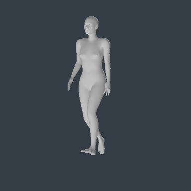
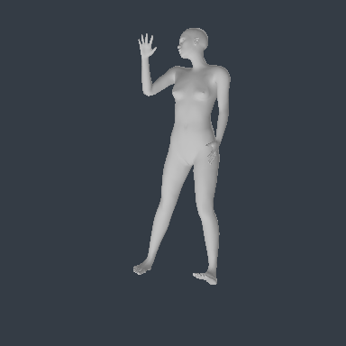
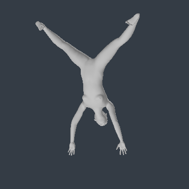

# CMU Motion Catalog

A searchable index of all 2,548 takes in the cgspeed 2010 MotionBuilder-friendly
BVH conversion of the CMU Graphics Lab Motion Capture Database. Each take has
a readable title, an action category or motion description, and two previews
rendered on MessCharacterCreator's Default Human.

| Walk Forward, 35_01 | Right-Hand Wave, 113_27 | Cartwheel, 121_02 |
| --- | --- | --- |
|  |  |  |
| [Open animated PNG](examples/35_01.png) | [Open animated PNG](examples/113_27.png) | [Open animated PNG](examples/121_02.png) |

## Download and use

Get [catalog.json from the v1.0.0 release](https://github.com/jvcleave/CMUMotionCatalog/releases/download/v1.0.0/catalog.json)
and the [17 preview ZIPs](https://github.com/jvcleave/CMUMotionCatalog/releases/tag/v1.0.0).
The preview ZIPs follow the same subject groups as the
[original BVH source packs](https://github.com/jvcleave/MessCharacterCreatorApp/releases/tag/cmu-bvh-2010-v1).

- Search titles, categories, tags, original descriptions, or take IDs such as
  `35_01`. IDs preserve the source zero padding. `sourceUUID` is the Creator
  source identity in the pinned original catalog.
- Select a take's `packID` in `previewPacks` for the ZIP URL, byte count and
  SHA-256. Inside it, `thumbnail.path` gives the static PNG and
  `animation.path` gives the looping APNG. The stills are 384 × 384 pixels
  and animations are 256 × 256 pixels.
- Frame numbers are one-based and skip the cgspeed calibration pose. Each
  animation uses up to 10 evenly spaced captured poses, including the first
  and last, with a fixed 150 ms per image. The original BVH provides the
  source playback timing.
- `labelOrigin` records how the title was chosen. `reviewed` takes have
  hand-edited labels, `source-description` takes use normalized upstream
  descriptions, and `motion-profile` takes describe travel and turning for
  source entries that provide no usable action name. `sourceDescription`
  preserves the text supplied by the conversion index where available.

## Contribute labels

Update the take's entry in [annotations.json](annotations.json) with a concise
action title, a category, and a few search tags. Use the stable take ID as the
key. Add an optional `posterFrame` when a different recorded pose shows
the action more clearly. The native renderer uses the same Default Human and
three-quarter framing as the Creator motion cards.

`tools/build_catalog.py` verifies the original BVHs and stages the requested
poses for offline rendering. `tools/package_previews.py` assembles the native
renders into preview archives and emits their checksums with the final catalog.
Both tools use Python 3.9 or later.

## Credits and source terms

The data used in this project was obtained from mocap.cs.cmu.edu. The database
was created with funding from NSF EIA-0196217.

The source captures come from the [CMU Graphics Lab Motion Capture Database](https://mocap.cs.cmu.edu/).
The MotionBuilder-friendly BVH conversion is by Bruce Hahne.
See the [CMU data terms](https://mocap.cs.cmu.edu/) and
[cgspeed conversion notes](https://sites.google.com/a/cgspeed.com/cgspeed/motion-capture/the-motionbuilder-friendly-bvh-conversion-release-of-cmus-motion-capture-database/readme-file-for-the-bvh-conversion-release).
The rendered Default Human uses the
[MPFB core assets prepared for MessCharacterCreator](https://github.com/jvcleave/MessCharacterCreatorApp/releases/tag/mpfb-core-2.0.18-r1).
