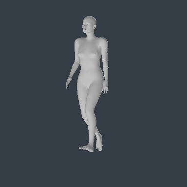
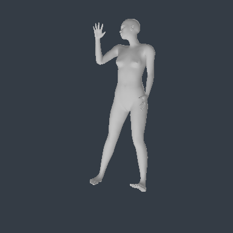
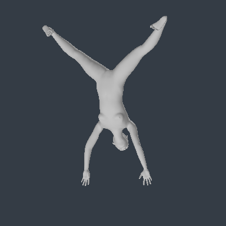

# Catalog

All 2,548 takes include an original BVH, a static PNG, and a looping animated
PNG in their subject pack directory. The complete catalog takes up about
3.3 GiB after extraction.

| Walk Forward, 35_01 | Right-Hand Wave, 113_27 | Cartwheel, 121_02 |
| --- | --- | --- |
|  |  |  |
| [Open animation](cmu-bvh-35-39/animations/35_01.png) | [Open animation](cmu-bvh-113-128/animations/113_27.png) | [Open animation](cmu-bvh-113-128/animations/121_02.png) |

## Data and files

- [catalog.json](catalog.json) lists every take with a reviewed title, action
  description, search tags, and original source description. The top-level
  `categories` defines the stable IDs used in each take's `primaryCategory`
  and optional `secondaryCategories`. Take IDs such as `35_01` preserve
  source zero padding. `sourceUUID` is the Creator source identity in the
  pinned original catalog.
- [source-catalog.json](source-catalog.json) is the pinned source index with
  archive and BVH paths, download URLs, source checksums, and timing.
- For local access, join `packID` and the file's `bvh.path`,
  `thumbnail.path`, or `animation.path` relative to this directory. For
  example, [the BVH for take 35_01](cmu-bvh-35-39/bvh/35/35_01.bvh) is at
  `cmu-bvh-35-39/bvh/35/35_01.bvh`. Each BVH entry records the size and
  SHA-256 of the original file.
- The stills are 384 × 384 pixels and the animations are 256 × 256 pixels.
  Each animation uses up to 10 evenly spaced captured poses, including the
  first and last, with a fixed 150 ms per frame. Frame numbers start at one
  and skip the cgspeed calibration pose.
- Some takes include named `segments` with inclusive start and end source
  frames, a `firstUsableFrame` note, or a `reviewNote`. These fields use the
  same one-based source frame coordinates as the previews.

The [complete catalog ZIP](https://github.com/jvcleave/CMUMotionCatalog/releases/download/v1.1.0/cmu-motion-catalog-v1.1.0.zip)
uses this same directory layout. The `previewPacks` entries refer to the
earlier [v1.0.0 preview-only release](https://github.com/jvcleave/CMUMotionCatalog/releases/tag/v1.0.0).

## Contribute labels

Edit the take's entry in the [action reviews](../review/) using its stable
take ID. From the repository root, run
`python3 -B review/publish_catalog.py 1.1.0` to validate the reviews and
regenerate the index and the [preview label overrides](annotations.json).
Pass `--check` to verify the generated files. The exporter keeps existing
poster frame overrides and leaves the BVH and preview files intact.

## Credits and source terms

The data used in this project was obtained from mocap.cs.cmu.edu. The database
was created with funding from NSF EIA-0196217.

The source captures come from the [CMU Graphics Lab Motion Capture Database](https://mocap.cs.cmu.edu/).
The MotionBuilder-friendly BVH conversion is by Bruce Hahne. See the
[CMU data terms](https://mocap.cs.cmu.edu/), the
[cgspeed conversion notes](https://sites.google.com/a/cgspeed.com/cgspeed/motion-capture/the-motionbuilder-friendly-bvh-conversion-release-of-cmus-motion-capture-database/readme-file-for-the-bvh-conversion-release),
and the [pinned source archive release](https://github.com/jvcleave/MessCharacterCreatorApp/releases/tag/cmu-bvh-2010-v1).
